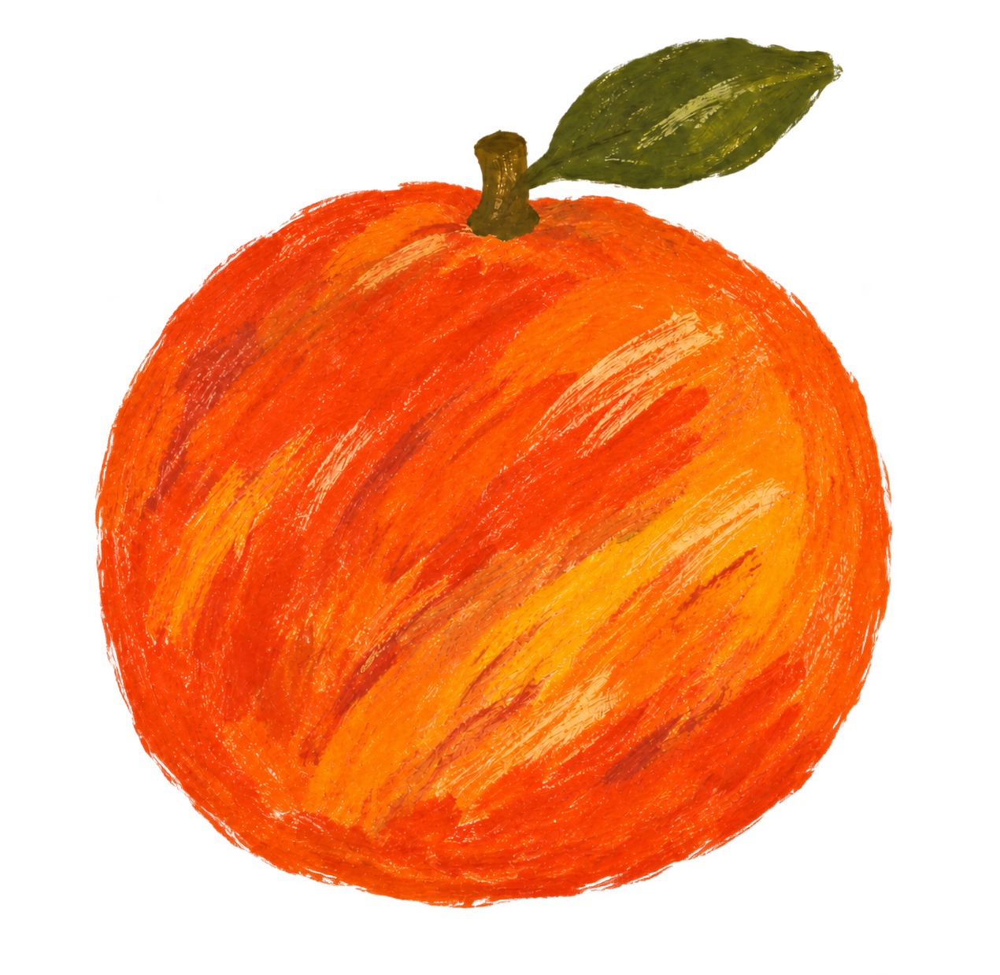

# 红美人柑橘单体

把用户提供的六张南瓜海报中的植物插画语言用于一颗红美人柑橘。先做包装正面的果实插画，再从包装稿提取带果梗与叶片的透明单体。这里归档单体成品与六张海报参考。

> **字体风格提取未成功。** 该部分未总结。以下记录仅用于复用果实单体插画。

[六张海报原图](../../风格库/风格档案/粗笔触果实单体/参考图/基准图/六张南瓜海报.jpg) · [逐图观察](../../风格库/风格档案/粗笔触果实单体/参考图/来源与观察.md) · [风格档案](../../风格库/风格档案/粗笔触果实单体/版本/第一版.json) · [任务数据](任务.json) · [验收](验收.md)

四版提示词按最终单体的要求整理，供下次生成使用。[中文 JSON](提示词/中文.json) · [英文 JSON](提示词/英文.json) · [中文简易](提示词/中文简易.md) · [完整自然语言](提示词/完整自然语言.md)

## 实际去底指令

去底时使用本对话中的包装稿为输入。六张海报用于前一步的风格参考。去底时提交的文字如下。

> 对提供的包装图执行精确抠图和去背景。只提取原图右边那一颗完整橙红色柑橘插画，连同它顶部短棕色果梗及向右上伸出的那一片深橄榄绿叶，保持它们的形状、相对大小、位置关系、颜色、干刷笔触和边缘的原始质感。用原图合成式主体分离，最大限度沿用原图具体的纹理和笔触，不另画水果。纸底（包括果梗和叶片附近空隙里可见的米白色）、左边文字和字标全部删除。交付仅包含这一颗柑橘单体的 RGBA 透明 PNG。主体完整居中，四边留少量全透明边距，无投影、白边、纸纹背景、色块、文字或装饰，背景是真实 alpha 透明，不画可见的棋盘格。
