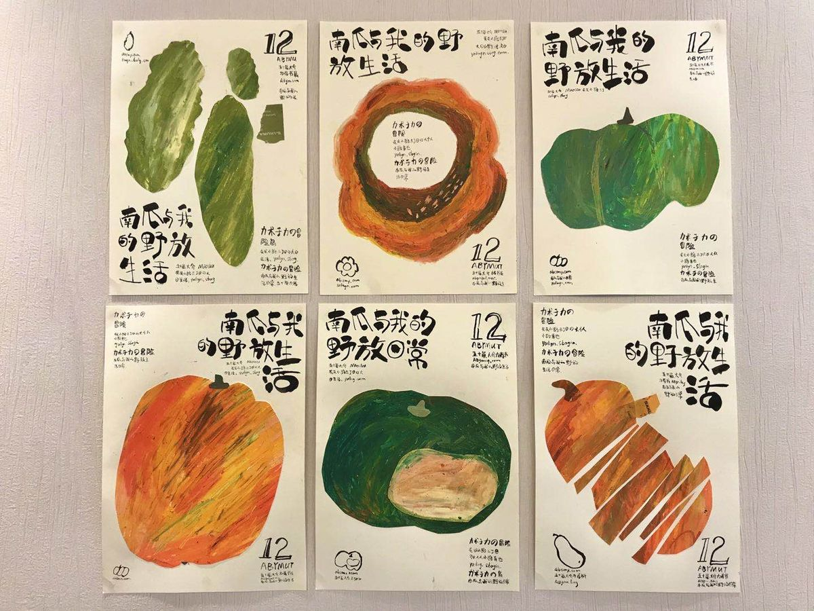

# 六张南瓜海报参考

来源为用户提供的六张海报合照，按原有两行三列顺序保存。原作者与对外出处待补。

| 位置 | 插画观察 |
| --- | --- |
| 左上 | 数个松散的绿色长形，轮廓轻微起伏，内部可见长向明暗刷痕。 |
| 中上 | 顺环形轮廓叠加橙红、棕赭和深色，中心留空，构成内外两道大轮廓。 |
| 右上 | 横向的绿色果形，整体用一块连贯剪影概括，深浅绿色在里侧擦叠。 |
| 左下 | 单一大果形内铺橙红、黄赭与少量深色，斜向拖痕清晰，色层有厚薄变化。 |
| 中下 | 深绿外形包住浅暖剖面，用少数高反差色块交代结构。 |
| 右下 | 连续果形拆成斜向切片，用窄留白分开。切片里仍保留长向笔迹和橙赭叠色。 |

这些表现共同支持「大轮廓、内部叠擦、细节集中」的提取。它们是同一题材和系列的样本，跨题材目前有一次柑橘迁移验证。

**字体风格提取未成功。本案例未作字体总结。**
